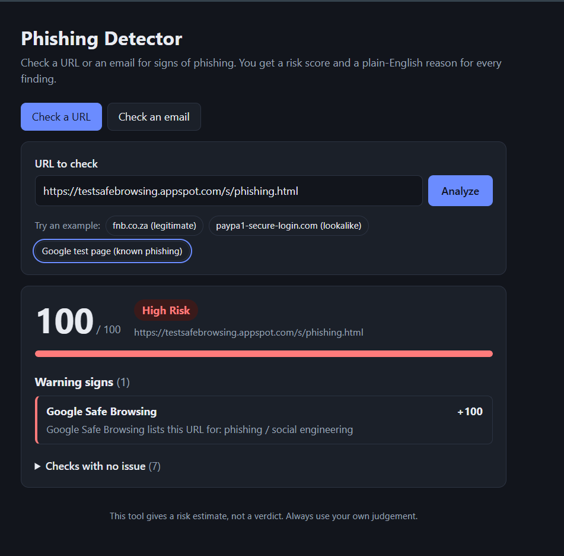
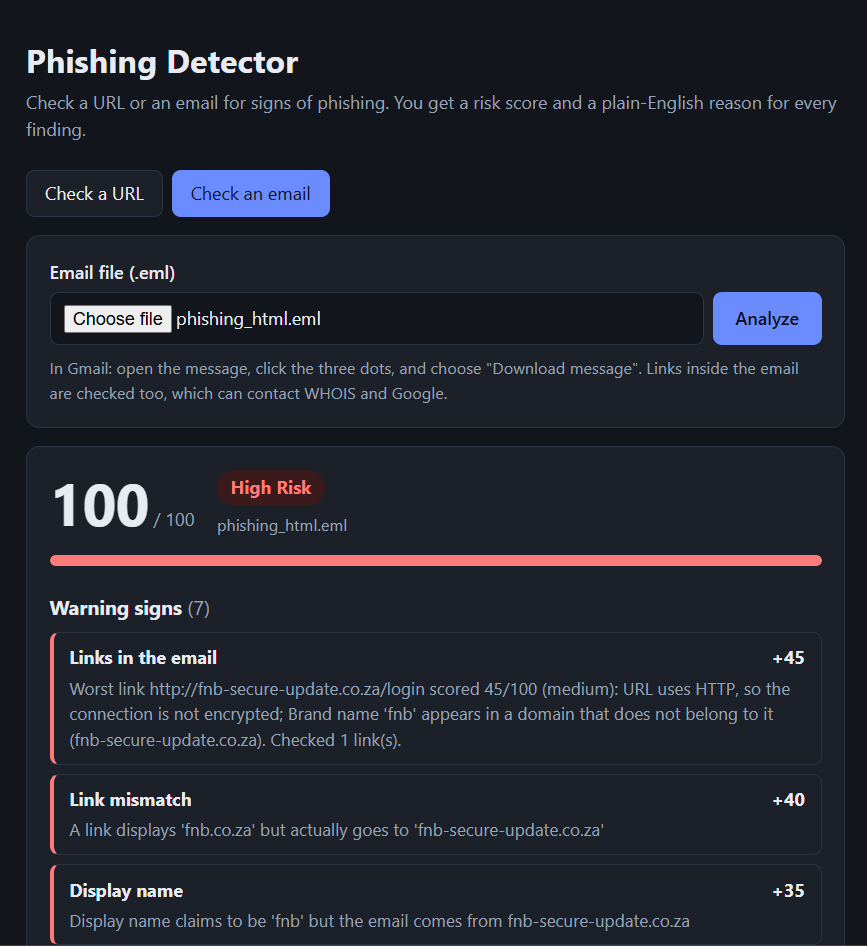

# Phishing Detector

A tool that analyzes URLs and emails for signs of phishing and returns a risk score (0-100) with a plain-English reason for every finding.

**Status:** URL analysis, email analysis and a web dashboard are working, and the app is deployed.

**Live demo:** https://YOUR-APP-NAME.onrender.com (hosted on a free tier, so the first load after a quiet period can take about a minute)

## Screenshots





## What it does

### URL analysis (`POST /analyze/url`)

Send a URL and get back a score, a risk level (low / medium / high), and one finding per check.

| Check | What it looks for |
|---|---|
| HTTPS | Plain HTTP instead of an encrypted connection |
| IP address | A raw IP address used instead of a domain name |
| Length | Unusually long URLs |
| Subdomains | Too many subdomain levels hiding the real domain |
| `@` trick | `google.com@evil.com`-style URLs, where the real host comes after the `@` |
| Typosquatting | Lookalikes of known brands (`paypa1.com`) and brand names hidden in a domain or subdomain |
| Domain age | Newly registered domains (WHOIS lookup) |
| Safe Browsing | Whether Google lists the URL as phishing or malware |

### Email analysis (`POST /analyze/email`)

Upload a `.eml` file and get the same kind of result.

| Check | What it looks for |
|---|---|
| SPF / DKIM / DMARC | Authentication failures reported in the `Authentication-Results` header |
| Reply-To mismatch | Replies going to a different domain than the sender's |
| Display name | A name like "PayPal Support" sent from an unrelated domain |
| Sender domain | Lookalike sender domains (reuses the typosquatting check) |
| Urgency wording | Pressure phrases such as "act now" or "will be suspended" |
| Link mismatch | A link that displays one domain but actually goes to another |
| Links | Every link in the email is run through the URL checks, and the worst one is reported |

## How scoring works

Each check returns a finding with a point value and a reason. The points from triggered checks are added up and capped at 100:

- **Low:** under 20
- **Medium:** 20 to 49
- **High:** 50 and above

The point values are hand-tuned. `tests/test_scoring_samples.py` holds a table of sample URLs with the risk level each should get, so changing a weight shows right away which examples change level.

Example response (shortened):

```json
{
  "url": "https://testsafebrowsing.appspot.com/s/phishing.html",
  "score": 100,
  "risk_level": "high",
  "findings": [
    {
      "check": "safe_browsing",
      "triggered": true,
      "points": 100,
      "reason": "Google Safe Browsing lists this URL for: phishing / social engineering"
    }
  ]
}
```

## Tech stack

- Python and FastAPI
- `tldextract`, `python-whois`, `requests`, `python-dotenv`, `python-multipart`
- Google Safe Browsing API (Lookup v4)
- pytest

## Getting started

Requires Python 3.10 or newer.

```bash
git clone https://github.com/Rejoice-M/phishing-detector.git
cd phishing-detector

python -m venv venv
source venv/Scripts/activate    # Windows (Git Bash); on macOS/Linux use: source venv/bin/activate

pip install -r requirements.txt
cp .env.example .env
```

Open `.env` and put your Google Safe Browsing API key after `SAFE_BROWSING_API_KEY=`. The key is optional: without it the Safe Browsing check reports "skipped" and everything else still works. Never commit your `.env` file.

Start the API:

```bash
uvicorn app.main:app --reload
```

Then open http://127.0.0.1:8000/ for the dashboard, or http://127.0.0.1:8000/docs for the interactive API docs.

## Running the tests

```bash
pytest
```

The tests never touch the internet. They use fake responses for WHOIS and Google, and the sample emails in `samples/` are made up.

## Project structure

```
app/
  main.py                  API endpoints
  scoring.py               turns findings into a score and risk level
  analyzers/
    url_analyzer.py        URL checks
    email_analyzer.py      email header and body checks
tests/                     unit tests and the sample-URL scoring table
samples/                   made-up .eml files for testing
frontend/                  dashboard (HTML, CSS, JavaScript)
```

## Known limitations

- The brand list used for lookalike detection is small, so it only catches imitations of brands it knows.
- Typosquatting can flag harmless domains that contain a brand name (for example `apple-pie.com`).
- The urgency phrase list is fixed and will miss new wording.
- Link mismatch can flag legitimate marketing emails that link through tracking redirects.
- SPF/DKIM/DMARC results are read from headers added by the receiving mail server, not recomputed. Emails without those headers can't be verified.
- WHOIS data is sometimes hidden or in formats the library can't read; the check then reports that the age couldn't be determined and adds no points.
- With the network checks on, URLs from analyzed emails are sent to Google for the Safe Browsing lookup.

## Roadmap

- [x] URL analysis
- [x] Email analysis (headers and body)
- [x] Web dashboard
- [x] Polish and deployment
- [ ] Stretch: machine-learning classifier as an extra signal
- [ ] Stretch: browser extension for real-time link scanning
